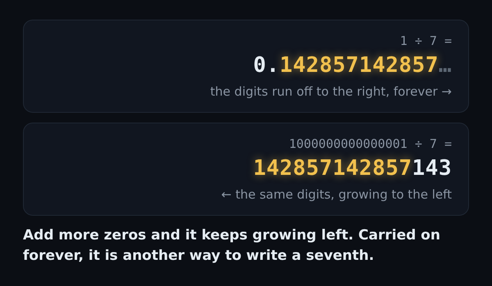

# Try this on a calculator first

Back to the [README](README.md). Then see [how this ties to Past Forever](GUIDE.md#how-this-ties-to-past-forever).

Any calculator works (turn your phone sideways if an answer gets cut off). Copy each sum exactly: the number of zeros matters, and one zero more or less spoils the trick. Do one step at a time, then open the answer.

**1.** Work out `90625 × 90625`. Look at the last five digits.

<details><summary>Answer</summary>

`8212890625`. It ends in **90625**, the number you started with.

</details>

**2.** Work out `9376 × 9376`. Look at the end.

<details><summary>Answer</summary>

`87909376`. It ends in **9376** again.

</details>

**3.** Add the two numbers: `90625 + 9376`.

<details><summary>Answer</summary>

`100001`. A 1, a row of zeros, and a 1.

</details>

**4.** Work out `66666667 × 3`. Look at the zeros.

<details><summary>Answer</summary>

`200000001`. Everything after the 2 is zeros and a final 1. So 66666667 acts a lot like a third.

</details>

**5.** Work out `1 ÷ 7`.

<details><summary>Answer</summary>

`0.142857142857…`. The digits **142857** repeat to the right, forever.

</details>

**6.** Now divide these by 7, one at a time, and compare them with step 5:

```
1001 ÷ 7
1000000001 ÷ 7
1000000000000001 ÷ 7
```

<details><summary>Answer</summary>

`143`, then `142857143`, then `142857142857143`.



</details>

**7.** Your turn. Try these, and compare them with `1 ÷ 11` and `1 ÷ 13`:

```
1001 ÷ 11
100001 ÷ 11
1000000001 ÷ 13
```

<details><summary>Answer</summary>

`91` and `9091`, while 1 ÷ 11 = `0.090909…`. And `76923077`, while 1 ÷ 13 = `0.076923076923…`.
The same digits again, growing to the left.

</details>
