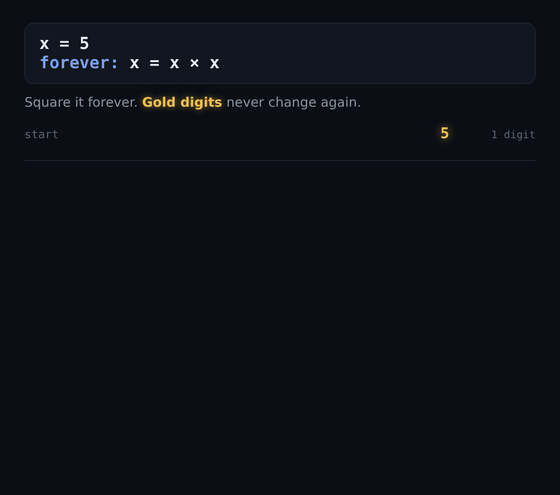
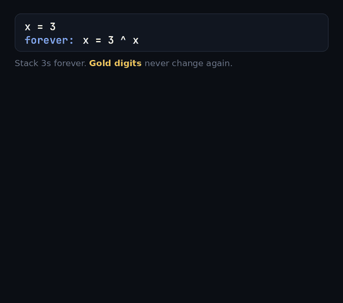
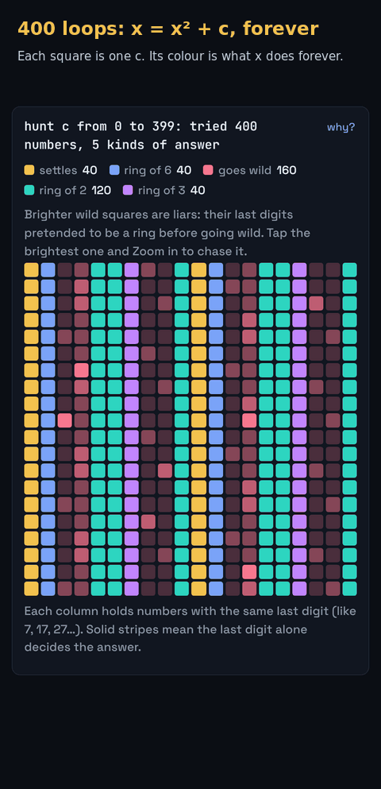

# A tour of Past Forever

Back to the [README](README.md).

## How this ties to Past Forever

This is real, old math with one different rule: digits go left forever, and two numbers count as close when their
endings match. Mathematicians call these 10-adic numbers, the base-10 cousin of
[p-adic numbers](https://en.wikipedia.org/wiki/P-adic_number) (Hensel, 1897). In that world …142857142857143 times 7
is exactly 1, and it counts as a whole number there (a 10-adic integer). It is not one of the ordinary whole numbers
you count with.

A calculator only ever sees the last few digits. Past Forever works with the whole endless left side. You write the
loop that never ends, like "square 5 forever" or "1 ÷ 7, the left way", and it tells you the endless answer, and
whether it ever settles at all.

```
x = 1 / 7
show x
show x × 7
```

```
…857142857143  (this is 1/7)
1
```

**Your calculator rounds. Past Forever doesn't.** Work out `1 ÷ 7` on a calculator and the last digit it shows is
rounded, like `0.1428571429` or `0.142857142857143`, because the real digits `142857` never stop. Past Forever
never holds all the digits. It finds the repeating pattern, so the answer is exact, and when it can't be sure it
says `can't see the end` instead of guessing.

Here it squares 5 forever. The gold digits are the ones that never change again:

<p align="center"></p>

If the digits settle, the program gets the finished number and carries on. If they never settle, it proves that
instead. If it can't tell, it says so.

**Try it in your browser:** [connabyss.github.io/past-forever](https://connabyss.github.io/past-forever/). No install, works on a phone.
New here? Take the [Wonders tour](https://connabyss.github.io/past-forever/#wonders): 7 surprises, one tap each.

## Four lines

```
x = 5
forever: x = x × x
show x
show x × x = x
```

```
…918212890625
yes  (proved)
```

5, 25, 625, 390625… Squaring forever never stops, but the digits on the right freeze, one or more at a time.
So after forever, `x` is an endless number that runs off to the left, and it is its own square. Ask `why x`
and it tells you how it knows.

It isn't the only one. 0 and 1 are their own squares, and so is its twin, `…081787109376` (start at 6 and take the
fifth power forever). Add the twins and you get `…000000000001`, which is 1. That's the `90625 + 9376 = 100001` from
the [calculator steps](CALCULATOR.md). The `why` for `…918212890625` says it is the one ending in 5, not the only one.

## The last digits of Graham's number

[Graham's number](https://en.wikipedia.org/wiki/Graham%27s_number) is defined with Knuth's up-arrows, 64 layers of
them. Unfold the last layer and it is a tower of 3s, `3 ^ 3 ^ … ^ 3`, so tall that the universe is too small to hold its digits. The tower does end somewhere, but nobody knows its first
digit. Past Forever can show you its last ones, by building the tower forever:

```
x = 3
forever: x = 3 ^ x
show x
show 3 ^ x = x
```

```
…262464195387
yes  (proved)
```

<p align="center"></p>

Once the tower is a few floors tall, every new floor freezes one more digit on the right. Why, in one line: two
powers 3^a and 3^b share their last k + 1 digits whenever a and b share their last k digits (for k ≥ 2), because 3
to the power 10^k ends in …0001 on its last k + 1 digits (Euler's theorem: λ(10^(k+1)) divides 10^k). So once two
floors in a row share their last 2 digits, each floor after that shares one more, and the last k digits stop
changing for good. Graham's number is a finite tower of 3s, far taller than any number of digits you
could ask for, so its last k digits are the endless tower's last k digits, for every k you can write down. Ask for `show 105 digits of x` and all 105 match the digits listed in the
[OEIS (A133613)](https://oeis.org/A133613). The tests check them on every build.

**Hear it.** `sing` plays any answer's digits as music, one note per digit, right to left: the order the digits
freeze in. Each digit picks a note from a five-note scale (0 lowest, 9 highest), so no order of digits can clash,
with a bass note every 4th digit and a bell every 10th. In the [playground](https://connabyss.github.io/past-forever/)
pick **Sing it** and press play, or [watch the last 360 digits of Graham's number go by on a paper piano
roll](https://connabyss.github.io/past-forever/sing.html) while they play. On your own computer, save a minute of Graham's number as a sound file:

```
node cli.js examples/sing.txt --wav graham.wav     # its last 360 digits, about a minute
```

The tune came from an explorer agent in a GitHub Codespace ([Breakers](HALL_OF_FAME.md#breakers) #7).

## Hunt: try a whole range at once

```
hunt c from 0 to 99:
    x = 0
    forever: x = x × x + c
    show x
```

```
hunt c from 0 to 99: tried 100 numbers, 5 kinds of answer
  settles     10   0, 10, 20, 30, 40, 50, 60, 70, …
  ring of 6   10   1, 11, 21, 31, 41, 51, 61, 71, …
  goes wild   40   2, 3, 7, 8, 12, 13, 17, 18, …
  ring of 2   30   4, 5, 9, 14, 15, 19, 24, 25, …
  ring of 3   10   6, 16, 26, 36, 46, 56, 66, 76, …
```

<p align="center"></p>

`ring of N` in a hunt means every digit Past Forever looked at, 40 deep, came round every N steps. It is what it
saw, not a proof, and a liar calmer than that fools it: c = 5^45 − 2 shows `ring of 2` but goes wild at digit 47.
Open one c on its own (`why x`) to see whether its ring is proved: `x = x × x + 1` says `And that is proved`,
because its ring passes 0, where the slope 2x is 0.

In the playground every number becomes a colored square. Some wild loops are **liars**: their last digits
go round a ring of 2 for a while, then the next digit breaks it. Brighter means it lied for longer.
Tap the brightest square and **Zoom in** (`ends in 123`) to see only numbers ending in those digits.
Following the brightest one goes 123 → 78123 → 5078123 → 205078123 → 85205078123, and that last one lies for 13 digits.
