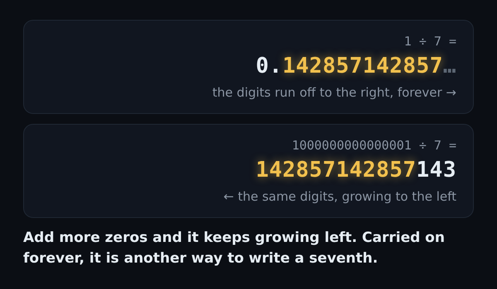
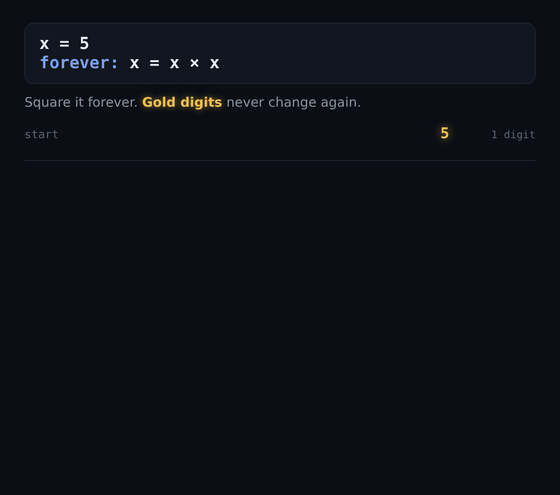
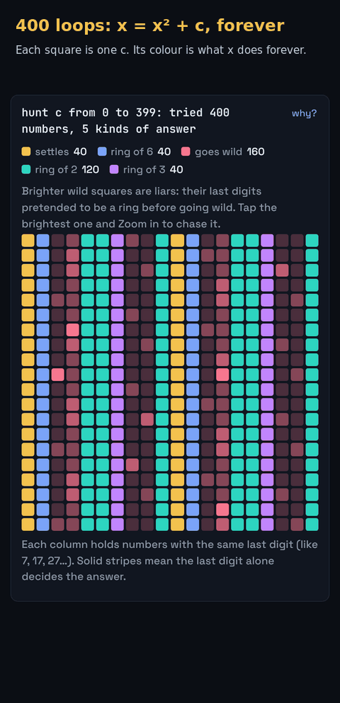

# Past Forever

**Write a loop that never ends. Get its answer anyway, exactly.** This loop never stops, and the program runs on past it:

```
x = 5
forever: x = x × x
show x
```

```
…918212890625
```

5, 25, 625, 390625… squared forever, and the digits on the right freeze. **Check it on any calculator:**
`918212890625 × 918212890625` ends in `…918212890625`. It is its own square.

Same trick, other answers: `1 ÷ 7 = …142857143` (check: `142857143 × 7 = 1000000001`, and the more 142857s you
add, the more zeros), and the last digits of [Graham's number](#the-last-digits-of-grahams-number).

**Try it in 10 seconds** (Node 18+, no dependencies):

```
git clone https://github.com/connabyss/past-forever && cd past-forever
node cli.js examples/graham.txt     # …262464195387, the end of Graham's number
```

**Found with it: loops that lie.** Run `x = x × x + c` from 0. For a wild c, the steps its last 1, 2, 3… digits
take to come round grow ×5 per digit (10, 50, 250…). A liar stays calm first: digit after digit the count stays at
1, 2 or 8, like a loop that has settled, and only then it goes wild. The record liars, each calm for more digits
than every smaller c, go 2, 7, 57, 182, 1068, 14557, 30982, 265357, 6139557, 8077857, … and the newest,
c = `38533618339183472936432`, stays calm for 35 digits. Check it yourself, in plain Python:

```python
c = 38533618339183472936432
for k in (34, 35, 36, 37):                    # look at the last k digits
    m, x, seen = 10**k, 0, {}
    while x not in seen:
        seen[x] = len(seen); x = (x * x + c) % m
    print(k, "digits come round every", len(seen) - seen[x], "steps")
# 34: 8,  35: 8,  then 36: 40,  37: 200, and ×5 for every digit after that
```

**Why they lie.** Two fresh AI agents worked this out on their own ([Hall of Fame](#hall-of-fame) #5), and it
matches what turned up while hunting. The last k digits run two clocks at once, one for the 2s in 10^k and one for
the 5s. The 2s clock never lies. The 5s clock does all of it, and every liar sits close, in base 5, to one of four
special values of c: −2, the two 5-adic square roots of −1, and one more that only a long equation names. So you
can make liars on purpose: c = 5^k − 2 stays calm for k + 1 digits.

**How we searched.** The first ten records came from trying every c up to 40 million, one by one, in two separate
programs. Past that, whether c stays calm for k digits depends only on c's remainder after dividing by 5^k, so the
calm remainders can be built one base-5 digit at a time, with nothing skipped (there are exactly 60 at every depth
from 5 on). The smallest one is the record, and each record was re-checked by brute force. "Nothing skipped" rests
on our reasoning and the agents', not on anyone's review. We searched the [OEIS](https://oeis.org) for the record
list in November 2026 and didn't find it, but many of its terms are close cousins of lists that are there: the
5-adic square roots of −1 ([A048898](https://oeis.org/A048898), [A048899](https://oeis.org/A048899)).

**Don't believe it? Good.** Pick the claim you trust least and check it with your own arithmetic. Then try to
[break it](#break-it): a wrong `proved` gets your name in the Hall of Fame. Coding agents: [AGENTS.md](AGENTS.md)
has a dare for you. (A word on `proved`: it means proved by a few hand-written rules, listed in
[How it knows](#how-it-knows) and tested by a robot referee on every build. No mathematician or proof checker has
looked at them yet.)

<p align="center"><a href="https://connabyss.github.io/past-forever/"></a></p>

<p align="center">or take the <a href="https://connabyss.github.io/past-forever/#wonders">Wonders tour</a>: 7 surprises, one tap each</p>

## First, try this on a calculator

Any calculator works (turn your phone sideways if an answer gets cut off). Copy each sum exactly: the number of zeros matters, and one zero more or less spoils the trick. Do one step at a time, then open the answer.

**1.** Work out `90625 × 90625`. Look at the last five digits.

<details><summary>Answer</summary>

`8212890625`. It ends in **90625**, the number you started with.

</details>

**2.** Work out `9376 × 9376`. Look at the end.

<details><summary>Answer</summary>

`87909376`. It ends in **9376** again.

</details>

**3.** Add the two numbers: `90625 + 9376`.

<details><summary>Answer</summary>

`100001`. A 1, a row of zeros, and a 1.

</details>

**4.** Work out `66666667 × 3`. Look at the zeros.

<details><summary>Answer</summary>

`200000001`. Everything after the 2 is zeros and a final 1. So 66666667 acts a lot like a third.

</details>

**5.** Work out `1 ÷ 7`.

<details><summary>Answer</summary>

`0.142857142857…`. The digits **142857** repeat to the right, forever.

</details>

**6.** Now divide these by 7, one at a time, and compare them with step 5:

```
1001 ÷ 7
1000000001 ÷ 7
1000000000000001 ÷ 7
```

<details><summary>Answer</summary>

`143`, then `142857143`, then `142857142857143`.



</details>

**7.** Your turn. Try these, and compare them with `1 ÷ 11` and `1 ÷ 13`:

```
1001 ÷ 11
100001 ÷ 11
1000000001 ÷ 13
```

<details><summary>Answer</summary>

`91` and `9091`, while 1 ÷ 11 = `0.090909…`. And `76923077`, while 1 ÷ 13 = `0.076923076923…`.
The same digits again, growing to the left.

</details>

## How this ties to Past Forever

This is real, old maths with one different rule: digits go left forever, and two numbers count as close when their
endings match. Mathematicians call these 10-adic numbers, the base-10 cousin of
[p-adic numbers](https://en.wikipedia.org/wiki/P-adic_number) (Hensel, 1897). In that world …142857142857143 times 7
is exactly 1, and it counts as a whole number there (a 10-adic integer). It is not one of the ordinary whole numbers
you count with.

A calculator only ever sees the last few digits. Past Forever works with the whole endless left side. You write the
loop that never ends, like "square 5 forever" or "1 ÷ 7, the left way", and it tells you the endless answer, and
whether it ever settles at all.

```
x = 1 / 7
show x
show x × 7
```

```
…857142857143  (this is 1/7)
1
```

**Your calculator rounds. Past Forever doesn't.** Work out `1 ÷ 7` on a calculator and the last digit it shows is
rounded, like `0.1428571429` or `0.142857142857143`, because the real digits `142857` never stop. Past Forever
never holds all the digits. It finds the repeating pattern, so the answer is exact, and when it can't be sure it
says `can't see the end` instead of guessing.

Here it squares 5 forever. The gold digits are the ones that never change again:

<p align="center"></p>

If the digits settle, the program gets the finished number and carries on. If they never settle, it proves that
instead. If it can't tell, it says so.

**Try it in your browser:** [connabyss.github.io/past-forever](https://connabyss.github.io/past-forever/). No install, works on a phone.
New here? Take the [Wonders tour](https://connabyss.github.io/past-forever/#wonders): 7 surprises, one tap each.

## Four lines

```
x = 5
forever: x = x × x
show x
show x × x = x
```

```
…918212890625
yes  (proved)
```

5, 25, 625, 390625… Squaring forever never stops, but the digits on the right freeze, one or more at a time.
So after forever, `x` is an endless number that runs off to the left, and it is its own square. Ask `why x`
and it tells you how it knows.

It isn't the only one. 0 and 1 are their own squares, and so is its twin, `…081787109376` (start at 6 and take the
fifth power forever). Add the twins and you get `…000000000001`, which is 1. That's the `90625 + 9376 = 100001` from
the calculator steps above. The `why` for `…918212890625` says it is the one ending in 5, not the only one.

## The last digits of Graham's number

[Graham's number](https://en.wikipedia.org/wiki/Graham%27s_number) can be written as a tower of 3s, `3 ^ 3 ^ … ^ 3`,
so tall that the universe is too small to hold its digits. The tower does end somewhere, but nobody knows its first
digit. Past Forever can show you its last ones, by building the tower forever:

```
x = 3
forever: x = 3 ^ x
show x
show 3 ^ x = x
```

```
…262464195387
yes  (proved)
```

<p align="center"></p>

Once the tower is a few floors tall, every new floor freezes one more digit on the right. Graham's number is a
finite tower, but far taller than any number of digits you could ask for, so it ends the same way as the endless one. Ask for `show 105 digits of x` and all 105 match the digits listed in the
[OEIS (A133613)](https://oeis.org/A133613). The tests check them on every build.

## Three honest answers

Every value that comes out of a forever loop is one of three things:

| answer | example | what it printed |
|---|---|---|
| a number, with proof | add 9, 90, 900, … forever | `…999999999999  (this is -1)` |
| **never settles**, with proof | `x = 6`, square forever | `never settles` (the last two digits go 36, 96, 16, 56 forever) |
| **can't see the end** | 196, reverse and add forever | `can't see the end` |

Searches work the same way. "Does some square end in 7?" answers `no  (proved)` after looking at infinitely many
squares. Counts can go past forever too: count to forever, add one, and you get `forever + 1`.

## Hunt: try a whole range at once

```
hunt c from 0 to 99:
    x = 0
    forever: x = x × x + c
    show x
```

```
hunt c from 0 to 99: tried 100 numbers, 5 kinds of answer
  settles     10   0, 10, 20, 30, 40, 50, 60, 70, …
  ring of 6   10   1, 11, 21, 31, 41, 51, 61, 71, …
  goes wild   40   2, 3, 7, 8, 12, 13, 17, 18, …
  ring of 2   30   4, 5, 9, 14, 15, 19, 24, 25, …
  ring of 3   10   6, 16, 26, 36, 46, 56, 66, 76, …
```

<p align="center"></p>

`ring of N` in a hunt means every digit Past Forever looked at, 40 deep, came round every N steps. It is what it
saw, not a proof, and a liar calmer than that fools it: c = 5^45 − 2 shows `ring of 2` but goes wild at digit 47.

In the playground every number becomes a coloured square. Some wild loops are **liars**: their last digits
go round a ring of 2 for a while, then the next digit breaks it. Brighter means it lied for longer.
Tap the brightest square and **Zoom in** (`ends in 123`) to see only numbers ending in those digits.
Following the brightest one goes 123 → 78123 → 5078123 → 205078123 → 85205078123, and that last one lies for 13 digits.

## Break it

Find one of these and your name goes in the Hall of Fame below:

- **A wrong answer.** A loop where Past Forever says `proved` and is wrong. This is the big one.
- **A loop it can't see the end of, but you can.** It says `can't see the end`, and you can show the real answer.
- **A fifth magnet.** In `x = x × x + c` from `x = 0`, every long liar we know sits close to one of the four values
  in "Why they lie" near the top. We think there are no others (a proof sketch, not reviewed).
  Find a c that stays calm for 20 digits or more without being close to one of the four, and the sketch is wrong.
  ("Find a longer liar" is closed: c = 5^k − 2 is as long as you like.)

To enter, open a [Break it issue](https://github.com/connabyss/past-forever/issues/new?template=break-it.yml)
with the code and what it printed.

### Hall of Fame

1. **Leo AI in Brave (Qwen).** Its "numbers that are their own square" challenge turned up a loop that starts
   on its own answer, …081787109376 squared forever, where Past Forever said `can't see the end`. It settles,
   and now Past Forever proves it. (November 2026)
2. **GPT Luna in Brave.** `x = (M + 1) × x + M` with M = 1 and 40 zeros: the last 40 digits never move, but the
   41st goes round 0 to 9 forever. Past Forever only looked 9 digits in and said `can't see the end`. Now it looks
   as deep as the biggest number in the loop, and proves `never settles`. (November 2026)
3. **GitHub Copilot.** `repeat 10 ^ 64: x = x + 1` had no time limit, so it froze the playground. Not a wrong answer,
   but a real hang. Now `repeat` stops with a clear message after 15 seconds (8 in the playground). (November 2026)
4. **A fresh Claude Opus agent, and GitHub Copilot.** Asked only to take a look, Opus tried a tower of 2s,
   `x = 2 ^ x`, where Past Forever said `can't see the end`. It settles, on …075353432948736. Copilot found the same
   gap with `x = 10 ^ x`, which settles on 0. Now every tower on a whole number from 2 up settles by its own rule.
   (November 2026)
5. **Two fresh Claude Opus agents, separately.** Asked to "use this language like a researcher", both worked out
   why liars exist (the 5s clock and the four special values of c), found the 34-digit record
   `8616755347677791280982`, and showed c = 5^k − 2 is a liar as long as you like. One of those, 5^45 − 2, fooled the
   hunt into saying `ring of 2`, so the hunt's why now says that rings are what it saw, not proofs. (November 2026)
6. **The Liar Race: Claude Haiku, Sonnet and Opus.** Three fresh agents raced to find the smallest c that stays calm
   for 35 digits. All three found `38533618339183472936432`, each by building the calm remainders in base 5. Sonnet
   got there first: "go count to 3.85e22 by hand." (November 2026)

## How it knows

There is no magic, only a few rules in [forever.js](forever.js), and each answer says which one it used:

- The whole state comes back: from then on it repeats forever.
- A digit stops changing, and the rule pulls nearby numbers together: one more digit locks in every step.
- A sum whose pieces end in more and more zeros settles.
- A power tower like `x = 3 ^ x`: when two tops share their last k digits, the powers share k + 1 (the bottom
  number must have no 2 or 5 in it). So once the last 2 digits stop changing, it settles.
- A tower on 2, 5, 10 or any other whole number from 2 up, like `x = 2 ^ x` from an ordinary whole number: every
  step is a whole number and they grow, so soon every top is bigger than any number of digits you ask for. Then the
  same lock-one-more rule holds, and it settles.
- The last digits go round a ring that never stops: proved never to settle.
- None of these fit: `can't see the end`.

## Honest notes

- **The maths is old.** Numbers that run off to the left are the 10-adic numbers named above. Counting past forever
  is Cantor's ordinals. The …212890625 number is an automorphic number. The frozen last digits of towers of 3s have been known for a long time too. What is new here, as far as we found,
  is a language you can actually run where code keeps going after a forever loop. Closest cousins: the
  Zeno esolang (an imaginary machine) and infinite time Turing machines
  (theory, not a language). Not finding one is not proof there isn't one.
- **"proved" means proved by the rules above**, as written in forever.js. They are not machine-checked, and no
  mathematician has reviewed them.
- **A robot referee checks them on every build.** [tests/referee.js](tests/referee.js) makes 3,375 random loops
  (squares, liars, straight-line rules, pairs, numbers passed back and forth, endless sums, power towers, towers on
  2, 5 and 10) and checks
  every `settles`, `never settles` and exact fraction against plain arithmetic on the last 30 or more digits. Last
  run: 4,660 answers, 0 wrong, 11 `can't see the end`. That is a strong check, not a proof.
- Rings and liars are checked 40 digits deep. A liar that lies for more than 40 digits would look like a ring.
- `can't see the end` comes up a lot. That's the language being honest, not a bug.

## Run it

You need Node.js 18 or newer. There are no dependencies.

```
git clone https://github.com/connabyss/past-forever && cd past-forever
node cli.js examples/own_square.txt --why
node tests/run.js        # ok: 615 checks
node tests/referee.js    # the robot referee, about 5 minutes
```

The playground is one file, [docs/index.html](docs/index.html). Rebuild it with `python3 page/build.py`.

## Where it came from

connabyss asked Claude (an AI) for a strange new language that would grow out of playing with numbers.
One idea from that play was a loop that finishes forever, and connabyss picked it. The language was built in a day
with Claude Code, and the liar loops turned up while hunting with it.

MIT licence.
